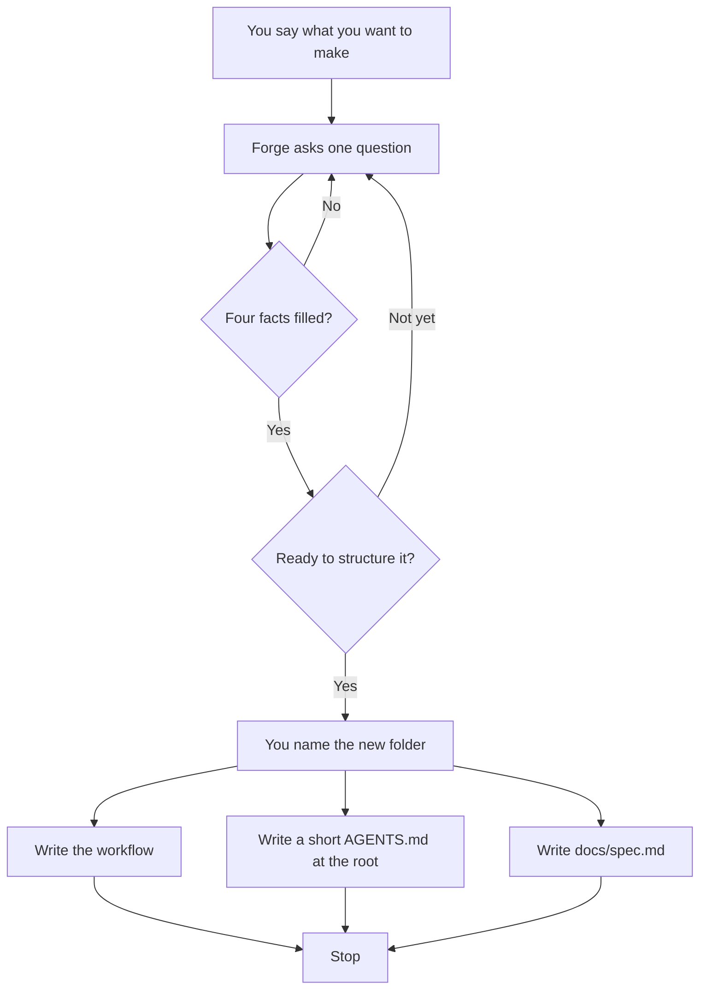
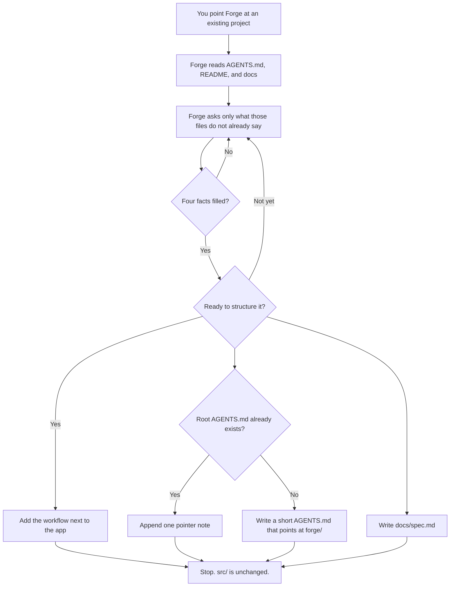

```
███████╗ ██████╗ ██████╗  ██████╗ ███████╗
██╔════╝██╔═══██╗██╔══██╗██╔════╝ ██╔════╝
█████╗  ██║   ██║██████╔╝██║  ███╗█████╗
██╔══╝  ██║   ██║██╔══██╗██║   ██║██╔══╝
██║     ╚██████╔╝██║  ██║╚██████╔╝███████╗
╚═╝      ╚═════╝ ╚═╝  ╚═╝ ╚═════╝ ╚══════╝
```

# Forge

> [!NOTE]
> EdHeltzel's ICM Rails

Forge is the rails for agentic ICM workspaces you keep in `~/Developer`. It is a framework, not the product you are building.

`/forge-interview` runs an adaptive invent-and-branch until enough-to-structure, then **generates** a thin generic ICM BASE from answers (no workbench/template copytree). Software rails are an optional later pack — not the core interview.

First run: [Getting started](docs/getting-started.md).

## Spec

Apply writes `docs/spec.md` unless you say you do not want one. Forge does not ask. If you say no, the agent sets `write_spec` to false and skips the file.

The file is a handoff, not the app and not the workflow. Sections: Problem, Solution, Scope, Out of scope, Interview. Problem is your `spec_problem` if you gave one, otherwise `what`. Solution is a stock sentence unless you set `spec_solution`. `done` is only inside the Interview JSON. There is no Done section.

`spec_dest: forge` writes the same file to this repo at `specs/<slug>.md` instead of the target.

## Greenfield

A new folder. Forge asks until it has what, who, done, and constraints, then lays the workflow and stops. It does not build the app.



Say you do not want a spec and that last write is skipped.

The workflow lives in `forge/`. Root `AGENTS.md` only points there.

## Brownfield

An existing app. Forge reads `AGENTS.md`, `README.md`, and `docs/`, asks only what those files do not already say, and adds the workflow beside the code.



Your README and app stay. If `AGENTS.md` was already there, Forge appends one pointer note. If it was missing, Forge writes a short one. The workspace contract stays in `forge/`. Running apply twice replaces that note. It does not stack. Say you do not want a spec and `docs/spec.md` is skipped. `src/` is still untouched.

