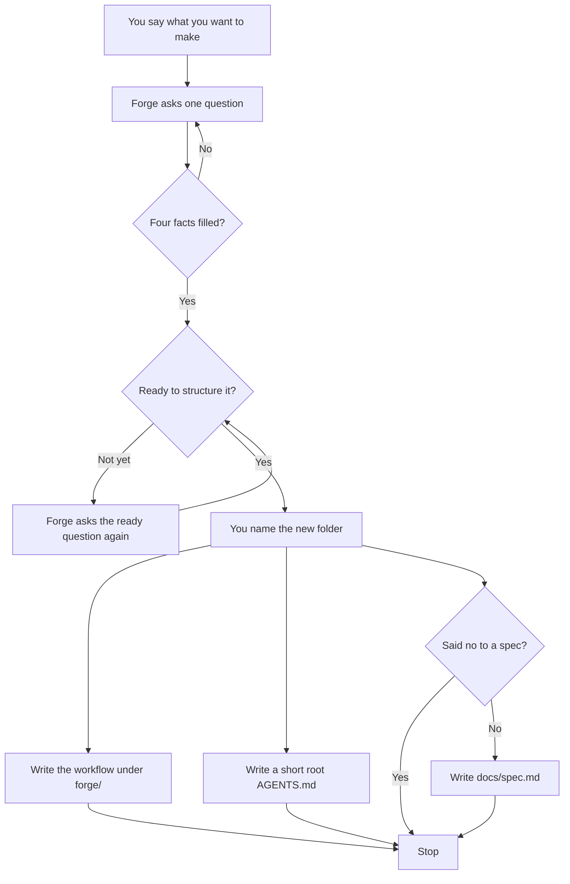

```
███████╗ ██████╗ ██████╗  ██████╗ ███████╗
██╔════╝██╔═══██╗██╔══██╗██╔════╝ ██╔════╝
█████╗  ██║   ██║██████╔╝██║  ███╗█████╗
██╔══╝  ██║   ██║██╔══██╗██║   ██║██╔══╝
██║     ╚██████╔╝██║  ██║╚██████╔╝███████╗
╚═╝      ╚═════╝ ╚═╝  ╚═╝ ╚═════╝ ╚══════╝
```

# Forge

Forge sets up ICM workspaces you keep in `~/Developer`. It is a framework, not the product you are building.

`/forge-interview` asks until it has what, who, done, and constraints, then writes the workflow from your answers. It does not copy a template. Software rails are an optional later pack. They are not the core interview.

Start with [Getting started](docs/getting-started.md).

## Spec

Forge writes `docs/spec.md` in the folder you name, unless you say you do not want that file. If that file is already there, Forge replaces it. Forge tells you this before it asks if you are ready.

Saying you are not ready does not skip the spec. Say you do not want the file if that is what you mean. When the interview ends, Forge names the path it wrote, or says the spec was skipped.

## Greenfield

A new folder. Forge asks until it has what, who, done, and constraints, then writes the workflow and stops. It does not build the project.



The workflow lives in `forge/`. A short note in root `AGENTS.md` points there. Forge does not edit `src/`.

## Brownfield

An existing folder. It does not have to be an app. If that folder is already open, Forge reads `AGENTS.md`, `README.md`, and `docs/` and does not ask again for facts those files already state. If it is not already open, Forge asks the four facts, then asks where to write. Forge does not search for a repo.

Your README stays. `src/` stays if you have one. Forge writes the workflow under `forge/`, next to the files already there.

