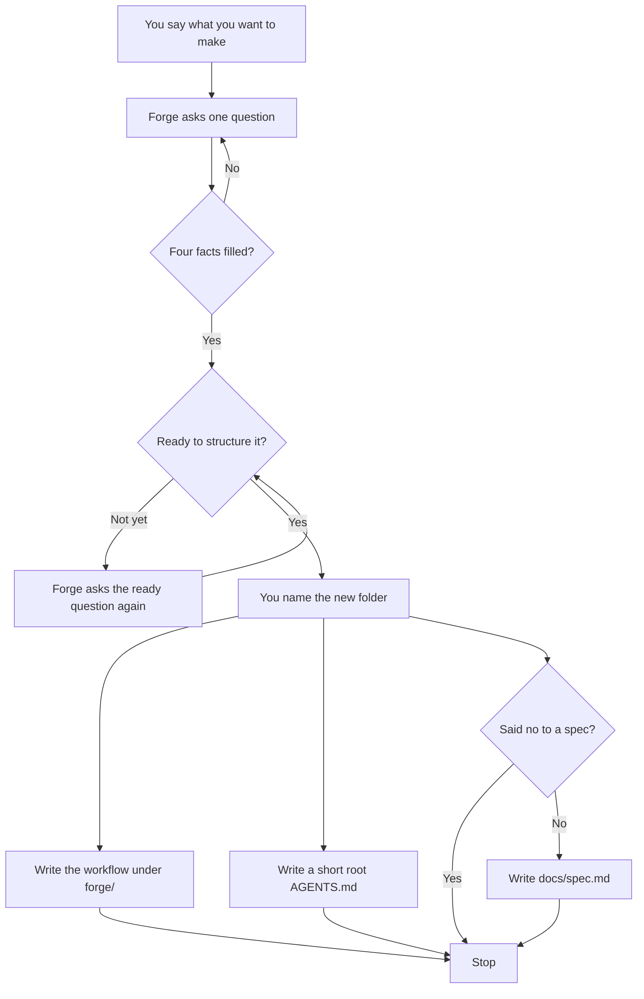

```
███████╗ ██████╗ ██████╗  ██████╗ ███████╗
██╔════╝██╔═══██╗██╔══██╗██╔════╝ ██╔════╝
█████╗  ██║   ██║██████╔╝██║  ███╗█████╗
██╔══╝  ██║   ██║██╔══██╗██║   ██║██╔══╝
██║     ╚██████╔╝██║  ██║╚██████╔╝███████╗
╚═╝      ╚═════╝ ╚═╝  ╚═╝ ╚═════╝ ╚══════╝
```

# Forge

Forge sets up ICM workspaces you keep in `~/Developer`. It is a framework, not the product you are building.

`/forge-interview` asks until it has what, who, done, and constraints, then writes the workflow from your answers. It does not copy a template. Software rails are an optional later pack. They are not the core interview.

Start with [Getting started](docs/getting-started.md).

## Spec

Forge writes `docs/spec.md` in the folder you name, unless you say you do not want that file. If the file is already there, Forge replaces it. Forge tells you this before the ready question.

A bare no, not yet, or wait means you are not ready. It does not skip the spec. Say you do not want the file if that is what you mean. The agent sets `write_spec` to false before apply runs. Setting the flag after apply does not delete a file already written. At the end, Forge names the path it wrote, or says the spec was skipped.

The file has five sections: Problem, Solution, Scope, Out of scope, and Interview. It is not the project, and it is not the workflow. Problem is `spec_problem` if you gave one, otherwise `what`. Solution is `spec_solution` if you set it. If you did not, Forge writes one sentence with the target path, the product, and the mode. The product is `generic`, not the type Forge inferred. Mode is `mode` from the answers, or `greenfield` if that key is missing. `done` is only in the Interview JSON. There is no Done section.

To put the spec in this repo instead, set `spec_dest` to `forge`. Forge writes `specs/<slug>.md` here. The root `AGENTS.md` note names that path when the file is written, and leaves the spec line out when the spec is skipped.

## Greenfield

A new folder. Forge asks until it has what, who, done, and constraints, then writes the workflow and stops. It does not build the project.



The workflow lives in `forge/`. Root `AGENTS.md` points there. When Forge writes a spec, that same note names it. The note also says not to edit `src/`.

## Brownfield

An existing folder. It does not have to be an app. If that folder is already open, Forge reads `AGENTS.md`, `README.md`, and `docs/` and does not ask again for facts those files already state. If it is not already open, Forge asks the four facts, then asks where to write. Forge does not search for a repo.

Your README stays. `src/` stays if you have one. Forge writes the workflow under `forge/`, next to the files already there.

If root `AGENTS.md` exists and both pointer markers are still there, a later run replaces that note. It does not add a second copy. That same run rewrites the files under `forge/`. If Forge writes a spec, it also rewrites `docs/spec.md`, including one that was already there. Forge skips the spec only when `write_spec` is false before that run.

