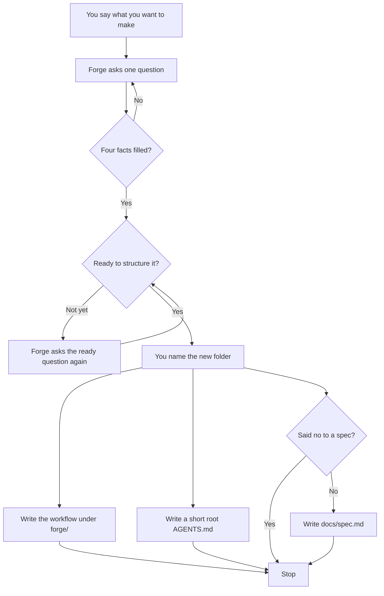

```
███████╗ ██████╗ ██████╗  ██████╗ ███████╗
██╔════╝██╔═══██╗██╔══██╗██╔════╝ ██╔════╝
█████╗  ██║   ██║██████╔╝██║  ███╗█████╗
██╔══╝  ██║   ██║██╔══██╗██║   ██║██╔══╝
██║     ╚██████╔╝██║  ██║╚██████╔╝███████╗
╚═╝      ╚═════╝ ╚═╝  ╚═╝ ╚═════╝ ╚══════╝
```

# Forge

> [!NOTE]
> EdHeltzel's ICM Rails

Forge is the rails for agentic ICM workspaces you keep in `~/Developer`. It is a framework, not the product you are building.

`/forge-interview` runs an adaptive invent-and-branch until enough-to-structure, then **generates** a thin generic ICM BASE from answers (no workbench/template copytree). Software rails are an optional later pack — not the core interview.

First run: [Getting started](docs/getting-started.md).

## Spec

Before the ready question, Forge says the workflow goes under `forge/` in the folder you name next, and that it will write `docs/spec.md` unless you say you do not want that file. If that file is already there, this replaces it. Saying you do not want it skips the file only if the agent puts `write_spec` false in the answers before apply runs. A bare no to the ready question is not that refusal. Setting the flag after apply does not delete a file already written. The close names the spec path, or says the spec was skipped.

The file is a handoff, not the project and not the workflow. Sections: Problem, Solution, Scope, Out of scope, Interview. Problem is your `spec_problem` if you gave one, otherwise `what`. Solution is `spec_solution` if you set it. Otherwise it names the target path, the generator product, and the mode. Day-one product is `generic`, not the inferred project type. Mode is `mode` from the answers, or `greenfield` if that key is missing. `done` is only inside the Interview JSON. There is no Done section.

If `docs/spec.md` already exists and you did not say no, apply overwrites it.

`spec_dest: forge` writes the same file to this repo at `specs/<slug>.md` instead of the target. The root `AGENTS.md` note names that path when the file is written, and omits the spec line when it is skipped.

## Greenfield

A new folder. Forge asks until it has what, who, done, and constraints, then lays the workflow and stops. It does not build the project.



The workflow lives in `forge/`. Root `AGENTS.md` points there. When a spec was written, that same note names it. The note also says not to edit `src/`.

## Brownfield

An existing folder. It does not have to be an app. If that folder is already open, Forge reads `AGENTS.md`, `README.md`, and `docs/` and does not re-ask facts those files already state. If it is not already open, Forge asks the four facts, then asks where to write. It does not go find a repo on its own.

Your README stays. `src/` stays if you have one. The workflow is written under `forge/`, beside what is already there.

If root `AGENTS.md` exists and both pointer markers are still there, a later run replaces that note. It does not add a second copy. That same run rewrites the files under `forge/`. If a spec is written, it also rewrites `docs/spec.md`, including one that was already there. Saying no skips the spec only when `write_spec` is false before that run.

